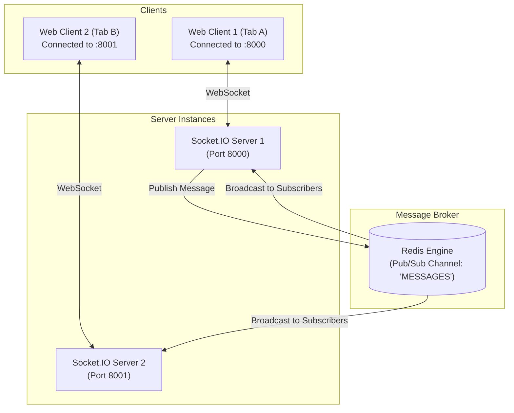

# Multi-Instance Real-Time Chat

A scalable, multi-instance real-time chat application built as a Turborepo monorepo. It demonstrates **horizontal scaling** of WebSocket connections across multiple independent server instances using **Redis Pub/Sub**.

---

## 🏗️ Architecture

When scaling WebSocket servers horizontally, clients connected to different server instances cannot directly communicate through in-memory socket rooms. This project solves that problem with a **Redis Pub/Sub** message broker:



1. **Client 1** sends a message to **Server 1** (`:8000`) over WebSockets.
2. **Server 1** publishes the message payload to the Redis `MESSAGES` channel.
3. **Redis** broadcasts the message to all subscribed server instances (**Server 1** and **Server 2**).
4. Both servers broadcast the message out to their local connected clients via Socket.IO.
5. **Client 2** on **Server 2** (`:8001`) receives the message in real-time.

---

## 🧰 Tech Stack

- **Monorepo**: [Turborepo](https://turbo.build/repo) + [pnpm](https://pnpm.io/)
- **Frontend** (`apps/web`):
  - [Next.js 16](https://nextjs.org/) (App Router)
  - [React 19](https://react.dev/)
  - [Socket.io-client](https://socket.io/docs/v4/client-api/)
  - [Tailwind CSS v4](https://tailwindcss.com/)
- **Backend** (`apps/server`):
  - [Express](https://expressjs.com/)
  - [Socket.io](https://socket.io/)
  - [ioredis](https://github.com/redis/ioredis)
  - [tsx](https://github.com/privatenumber/tsx)
- **Infrastructure**:
  - [Docker Compose](https://docs.docker.com/compose/) (Redis)

---

## 📁 Repository Structure

```text
Multi-Instance-Chat/
├── apps/
│   ├── server/               # Express + Socket.IO + ioredis backend
│   │   ├── src/
│   │   │   ├── services/
│   │   │   │   └── socket.ts # SocketService & Redis Pub/Sub integration
│   │   │   └── index.ts      # Server bootstrap & port listener
│   │   ├── package.json
│   │   └── tsconfig.json
│   └── web/                  # Next.js 16 chat interface
│       ├── app/
│       │   ├── context/
│       │   │   └── SocketProvider.tsx # React context managing socket connection
│       │   ├── page.tsx      # Chat UI component
│       │   └── layout.tsx
│       └── package.json
├── docker-compose.yml        # Redis container definition
├── package.json              # Root package and monorepo scripts
├── pnpm-workspace.yaml
└── turbo.json
```

---

## 🚀 Getting Started

### Prerequisites

- **Node.js**: `v22+` or `v24+`
- **pnpm**: `v10+` or `v11+`
- **Docker** and **Docker Compose** installed and running

### 1. Install Dependencies

```bash
pnpm install
```

### 2. Start Redis

Run Redis using Docker Compose:

```bash
docker compose up -d
```

Verify that Redis is running on port `6379`:

```bash
docker compose ps
```

### 3. Start Default Development Environment

Run both the Next.js frontend (`:3000`) and the default Socket.IO server (`:8000`):

```bash
pnpm dev
```

- Web UI: [http://localhost:3000](http://localhost:3000)
- Server 1: [http://localhost:8000](http://localhost:8000)

---

## 🧪 Testing Multi-Instance Scaling

To verify that multiple distributed backend instances communicate across Redis:

### Step 1: Start a Second Server Instance

In a separate terminal window, launch a second server instance listening on port `8001`:

```bash
PORT=8001 pnpm --filter server dev
```

You now have two active server nodes:

- Node 1 on `http://localhost:8000`
- Node 2 on `http://localhost:8001`

### Step 2: Open Connected Browser Tabs

1. **Tab 1 (Connected to Server 1)**:
   Navigate to [http://localhost:3000](http://localhost:3000)

2. **Tab 2 (Connected to Server 2)**:
   Navigate to [http://localhost:3000/?port=8001](http://localhost:3000/?port=8001)

### Step 3: Chat in Real-Time

- Type a message in **Tab 1** and press send.
- The message will appear instantly in **Tab 2**!
- Check your server terminals: you will see the message published from Server 1 and delivered to Server 2 via Redis Pub/Sub.

---

## 🛠️ Available Scripts

| Command                              | Description                                                    |
| ------------------------------------ | -------------------------------------------------------------- |
| `pnpm dev`                           | Starts all applications in development mode with hot-reloading |
| `PORT=8001 pnpm --filter server dev` | Starts an additional server instance on custom port `8001`     |
| `pnpm build`                         | Builds all packages and apps via Turbo                         |
| `pnpm lint`                          | Runs ESLint across all projects                                |
| `pnpm format`                        | Formats all files with Prettier                                |
| `docker compose up -d`               | Starts the Redis service in the background                     |
| `docker compose down`                | Stops the Redis service                                        |
